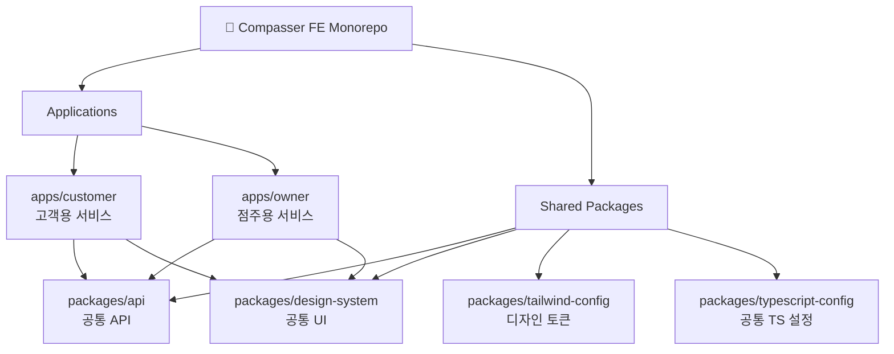

고객용 서비스와 점주용 서비스를 하나의 모노레포에서 관리하며,
공통 UI·API·개발 설정을 패키지화한 Compasser 프론트엔드 저장소입니다.

<div align="center">

# 🧭 COMPASSER Frontend

### 위치 기반 카페 랜덤박스 구매 및 QR 적립 서비스

<br />

[](https://compasser-customer.vercel.app)

<br />


</div>

---

## 📌 Project Overview

Compasser는 사용자가 주변 카페를 탐색하고 랜덤박스를 구매한 뒤,
매장에서 QR을 통해 상품을 확인하고 스탬프를 적립할 수 있는 서비스입니다.

프론트엔드는 서비스 이용 주체에 따라 고객용 앱과 점주용 앱을 분리하고,
두 앱에서 반복되는 UI·API·설정은 공통 패키지로 관리했습니다.

| 구분              | 설명                              |
| --------------- | ------------------------------- |
| `Customer`      | 카페 탐색, 랜덤박스 구매, 결제, QR 및 스탬프 관리 |
| `Owner`         | 매장과 랜덤박스 운영을 위한 점주용 서비스         |
| `Design System` | 공통 UI 컴포넌트와 디자인 규칙 관리           |
| `API Package`   | 고객용·점주용 앱에서 사용하는 API 로직 공통화     |

---

## 👩‍💻 Frontend Contribution

> **프론트엔드 1인 개발을 담당하며 설계부터 기능 구현, API 연동, 배포까지 전 과정을 수행했습니다.**

| 영역      | 구현 내용                                    | 결과                                      |
| ------- | ---------------------------------------- | --------------------------------------- |
| 아키텍처    | 고객용·점주용 앱을 분리한 도메인 기반 모노레포 설계            | 각 서비스의 역할을 분리하면서 공통 코드를 재사용할 수 있는 구조 확보 |
| 디자인 시스템 | 공통 UI 컴포넌트를 별도 패키지로 구성하고 Storybook 적용    | 서비스 간 UI 일관성 확보 및 컴포넌트 단위 개발 환경 구축      |
| 공통 모듈   | API, Tailwind, TypeScript 설정을 내부 패키지로 분리 | 앱마다 반복되던 설정과 API 구현 범위 축소               |
| 핵심 기능   | 랜덤박스 탐색·구매·결제, QR 확인, 스탬프 적립 기능 구현       | 탐색부터 오프라인 사용까지 이어지는 사용자 흐름 완성           |
| 협업      | 백엔드 개발자 3명, 디자이너 1명과 API 및 UI 명세 조율      | 프론트엔드 인터페이스와 데이터 흐름을 일관된 구조로 연결         |

### ✨ Architecture Impact

* 고객용 앱과 점주용 앱의 역할을 분리하면서 공통 패키지를 재사용하도록 구성
* UI·API·설정 패키지 통합을 통해 앱별 반복 구현 범위를 **약 50% 축소**
* 새로운 앱이나 기능이 추가되어도 공통 패키지를 확장할 수 있는 구조 마련
* 공통 컴포넌트를 Storybook에서 독립적으로 확인하고 관리할 수 있도록 구성

---

## 🏗️ Monorepo Architecture

<div align="center">

### 📚 Architecture References

[](https://turborepo.com/docs/crafting-your-repository/structuring-a-repository)
[](https://pnpm.io/workspaces)
[](https://storybook.js.org/docs)

</div>



### Directory Structure

```text
FE
├── apps
│   ├── customer
│   │   └── 고객용 웹 애플리케이션
│   └── owner
│       └── 점주용 웹 애플리케이션
│
├── packages
│   ├── api
│   │   └── 공통 API 요청 및 응답 로직
│   ├── design-system
│   │   └── 공통 UI 컴포넌트 및 Storybook
│   ├── tailwind-config
│   │   └── 공통 스타일과 디자인 토큰
│   └── typescript-config
│       └── 공통 TypeScript 설정
│
├── pnpm-workspace.yaml
├── turbo.json
└── package.json
```

### 구조 설계 기준

`apps`에는 고객용·점주용 서비스처럼 각각 독립적으로 실행되는 애플리케이션을 배치했습니다.

`packages`에는 두 애플리케이션에서 함께 사용하는 UI, API, 스타일, TypeScript 설정을 배치했습니다.

이를 통해 각 앱은 자신의 도메인 기능에 집중하고, 공통 변경 사항은 패키지 한 곳에서 관리할 수 있도록 구성했습니다.

---

## 🎨 Design System

<div align="center">


### 서비스 전반에서 재사용할 수 있는 공통 UI 패키지

</div>

공통 컴포넌트를 `packages/design-system`으로 분리하고 Storybook을 적용했습니다.

* Button, Input, Modal 등 공통 UI 컴포넌트 패키지화
* 고객용·점주용 앱에서 동일한 컴포넌트 재사용
* 컴포넌트 상태와 사용 방법을 Storybook에서 독립적으로 확인
* 공통 디자인 토큰을 통해 색상·타이포그래피·간격 일관성 유지
* UI 수정 사항을 한 패키지에서 관리하여 앱별 중복 수정 방지

---

## 🎯 Key Features

### 1. 위치 기반 카페 탐색

사용자의 현재 위치를 기반으로 주변 카페와 이용 가능한 랜덤박스를 탐색할 수 있습니다.

### 2. 카페별 랜덤박스 구매

카페에서 판매하는 랜덤박스의 정보와 가격을 확인하고 구매할 수 있습니다.

### 3. 결제 및 주문 흐름

상품 선택부터 주문 확인과 결제까지 이어지는 사용자 흐름을 구현했습니다.

### 4. QR 기반 상품 확인

구매한 랜덤박스를 매장에서 사용할 수 있도록 QR 기반 확인 흐름을 제공합니다.

### 5. 스탬프 적립 및 관리

카페 이용 내역에 따라 스탬프를 적립하고 보유 현황을 확인할 수 있습니다.

### 6. 고객·점주 서비스 분리

고객과 점주의 사용 목적에 맞게 앱을 분리하면서도 공통 코드와 디자인 시스템은 함께 사용합니다.

---

## 🛠️ Tech Stack

<div align="center">


</div>

| 분류             | 기술                        |
| -------------- | ------------------------- |
| Framework      | Next.js, React            |
| Language       | TypeScript                |
| Styling        | Tailwind CSS              |
| Server State   | TanStack React Query      |
| Client State   | Zustand                   |
| Monorepo       | Turborepo, pnpm Workspace |
| UI Development | Storybook                 |
| Deployment     | Vercel                    |

---

## 🚀 Getting Started

### 1. Repository clone

```bash
git clone https://github.com/CUK-Compasser/FE.git
cd FE
```

### 2. Install dependencies

```bash
pnpm install
```

### 3. Run development environment

```bash
pnpm dev
```

### 4. Build

```bash
pnpm build
```

### 5. Type check

```bash
pnpm type-check
```

---

<div align="center">

### COMPASSER

**사용자와 카페를 랜덤박스로 연결합니다.**

</div>
